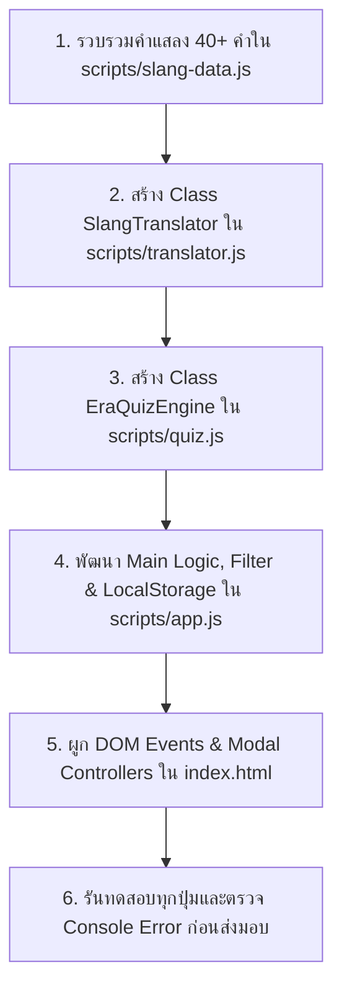

# ⚙️ Feature & Logic Builder Skill: "แปลทีดิtionary" (PlaeThee-tionary)

เอกสารฉบับนี้เป็นคู่มือปฏิบัติการสำหรับ **AI Agent** เมื่อต้องรับผิดชอบงานด้าน **การพัฒนาฟังก์ชันใหม่ (New Feature), ตรรกะระบบ (Business Logic), การจัดการชุดข้อมูลคำแสลง, และการประมวลผล JavaScript (ES6+)** ของเว็บแอปพลิเคชัน "แปลทีดิtionary"

---

## 🎯 1. พันธกิจและมาตรฐานด้านตรรกะระบบ (Mission & Architecture Objectives)

ระบบฟังก์ชันและฟีเจอร์ของ "แปลทีดิtionary" ต้องทำงานได้สมบูรณ์แบบ 100% ตอบสนองรวดเร็ว (Instant Feedback) ปราศจากบั๊กในเบราว์เซอร์คอนโซล และแยกไฟล์อย่างเป็นระเบียบตามหลัก Modular Architecture

* **ขอบเขตโฟลเดอร์ Scripts:** `scripts/slang-data.js`, `scripts/translator.js`, `scripts/quiz.js`, `scripts/app.js`
* **เทคโนโลยีบังคับ:** Pure Vanilla JavaScript (ES6+ Standards) ปราศจาก External Bundlers / Libraries

---

## ✅ 2. กฎสิ่งที่ AI ต้องทำ (Mandatory Feature Requirements & Do's)

### 2.1 สถาปัตยกรรมโค้ดแบบแยกโมดูล (Modular Separation of Concerns)
ต้องแบ่งความรับผิดชอบของโค้ดอย่างเคร่งครัดตามไฟล์ต่อไปนี้:
1. **`scripts/slang-data.js`:** 
   - จัดเก็บ Array ของคำแสลงทั้งหมดในตัวแปร `const SLANG_DATABASE = [...]`
   - ต้องมีคำแสลงจริงไม่น้อยกว่า 40 คำ (กระจายอย่างน้อย 10 คำต่อยุค: 90s, 2000s, 2010s, 2020s)
   - แต่ละคำต้องมี 5 ฟิลด์บังคับ: `id`, `word`, `pronunciation`, `era`, `formalMeaning`, `origin`, `examples` (บทสนทนา 2 ฝ่าย), `popularity`, และ `category`
2. **`scripts/translator.js`:**
   - คลาส/อ็อบเจกต์ `SlangTranslator` รับผิดชอบตรรกะการแปลข้อความทั้ง 2 ทิศทาง:
     - แสลง ➡️ ทางการ
     - ทางการ ➡️ แสลง
   - **อัลกอริทึม Longest-Match-First:** จัดเรียงคำตามความยาวตัวอักษรจากมากไปหาน้อยก่อนเริ่มกระบวนการค้นหาและแทนที่คำ เพื่อป้องกันการจับคู่ทับซ้อน (เช่น "ชีทำถึง" ต้องถูกแปลก่อนคำว่า "ทำ")
   - ครอบคำที่ถูกแปลด้วยแท็ก `<mark class="translated-word" data-word-id="...">` พร้อมแสดงแถบรายการคำศัพท์ที่ตรวจพบ
3. **`scripts/quiz.js`:**
   - คลาส/อ็อบเจกต์ `EraQuizEngine` รองรับข้อสอบ 5 ข้อ
   - ประมวลผลคะแนน 4 ยุค และคำนวณยุคที่มีคะแนนสูงสุด (Dominant Era)
   - สร้าง Badge และ Title ประจำตัว (เช่น "เด็กสยาม Y2K ตัวจริง", "ประชากร TikTok ตัวตึง") พร้อมฟังก์ชันคัดลอกผลลัพธ์ลงคลิปบอร์ด
4. **`scripts/app.js`:**
   - ควบคุม Event Listeners ทั้งหมดในหน้าเว็บ
   - เชื่อมโยง Time Machine Era Selector กับ `document.documentElement.setAttribute('data-theme', era)`
   - จัดการระบบ Instant Real-time Search และ Category Filter
   - จัดการ LocalStorage สำหรับระบบ Bookmark (`localStorage.getItem('plaethee_bookmarks')`)
   - ปุ่ม **"สุ่มคำแสลงทีดิ!" (Random Slang)** สุ่มคำแล้วเปิด Modal ไฮไลต์ทันที

### 2.2 ความถูกต้องและความสมบูรณ์ของข้อมูล (Data Authenticity)
1. ข้อมูลคำแสลงทุกคำต้องเป็นคำที่มีอยู่จริงในวัฒนธรรมเน็ตไทย:
   - **ยุค 90s:** จ๊าบ, ปิ๊ง, นอยด์, เซ็งเป็ด, ดักแก่, กิ๊ก, ป้าดโธ่, อะฮ้า, ปลื้มปริ่ม, กินเด็ก
   - **ยุค 2000s:** แอ๊บแบ๊ว, เด็กแนว, เกรียน, ขำกลิ้ง, บับว่า, ตัวแม่ (ยุคเริ่มต้น), ชิเมโจได๋, ปลวก, รูปร่างดี, ตะเอง
   - **ยุค 2010s:** จุงเบย, บ่องตง, ฝุดๆ, มโน, อัลไล, ติ่ง, นก, เผือก, มองบน, ตะมุตะมิ
   - **ยุค 2020s:** ช็อตฟีล, ดึงดาว, นอยด์อะแก, ฉ่ำ, จึ้ง, สภาพ, ตัวตึง, ชีทำถึง, ตัวบุตร, เต็มคาราเบล, วาสนาผู้ใด, สกิบิดี้
2. ตัวอย่างประโยคต้องแสดงบริบทการนำไปใช้จริงในรูปแบบแชท

### 2.3 ความทนทานและการจัดการข้อผิดพลาด (Robustness & Error Handling)
1. ทุกปุ่มกด (Buttons) ในระบบต้องมี Event Listener ผูกติดและตอบสนองได้จริง
2. ช่องค้นหา (Search) และกล่องแปลข้อความ (Translator) ต้องมี Fallback State เช่น เมื่อไม่พบคำค้นหาให้แสดงข้อความว่างเปล่าอย่างเป็นมิตร (Empty State)
3. ตรวจสอบผ่าน Browser DevTools Console ต้องไม่มี Uncaught Error ใดๆ เกิดขึ้นแม้แต่ตัวเดียว

---

## ⛔ 3. กฎสิ่งที่ AI ห้ามทำโดยเด็ดขาด (Strict Feature Don'ts)

1. ❌ **ห้ามเขียนโค้ดมัดรวมเป็น Monolithic Script ก้อนเดียว:**
   - ห้ามยัด Logic แปลภาษา, ฐานข้อมูล, และเกม รวมไว้ใน `<script>` ก้อนเดียวใน `index.html` ต้องแยกไฟล์ตามโครงสร้างเท่านั้น
2. ❌ **ห้ามใช้ External Libraries หรือ Frameworks:**
   - ห้ามนำเข้า React, Vue, jQuery, Lodash หรือ Bundler ภายนอก ให้ใช้ Pure Modern Vanilla JS (ES6+)
3. ❌ **ห้ามใช้ Placeholder Text หรือ Mock Data ไร้ความหมาย:**
   - ห้ามใส่ "Lorem Ipsum", "ข้อความตัวอย่าง 123", "คำศัพท์ A B C" ทุกข้อมูลต้องเป็นวัฒนธรรมไทยจริง
4. ❌ **ห้ามปล่อยให้มี Broken Buttons หรือ Dead Links:**
   - ปุ่มกดใน UI ทุกปุ่มต้องทำงานได้ ไม่มีการคลิกแล้วเงียบหาย
5. ❌ **ห้ามละเมิด LocalStorage Isolation:**
   - คีย์ที่จัดเก็บใน LocalStorage ต้องมี prefix เฉพาะ เช่น `plaethee_bookmarks` เพื่อไม่ให้ทับซ้อนกับโปรเจกต์อื่น

---

## 📋 4. ลำดับขั้นตอนการพัฒนาฟังก์ชัน (Feature Execution Sequence)

---

## 🧪 5. รายการตรวจสอบก่อนส่งมอบฟังก์ชัน (Feature Acceptance Checklist)

- [ ] **Data Integrity:** มีคำแสลงแสดงผลครบอย่างน้อย 40 คำ กระจายครบทั้ง 4 ยุค
- [ ] **Instant Search:** พิมพ์ค้นหาแล้วแสดงผลแบบ Real-time ค้นหาได้ทั้งคำแสลงและความหมาย
- [ ] **Translator Engine:** แปลข้อความไป-กลับได้จริง และใช้อัลกอริทึม Longest-Match-First ไฮไลต์คำที่แปลถูกต้อง
- [ ] **Quiz Gameplay:** ทำแบบทดสอบครบ 5 ข้อ แล้วคำนวณคะแนนแสดง Badge ประจำยุคได้ถูกต้อง
- [ ] **Bookmarks Persistence:** บันทึกคำโปรดลง LocalStorage แล้วกด Refresh ข้อมูลยังคงอยู่ครบถ้วน
- [ ] **Zero Console Errors:** เมื่อเปิด Console ตรวจสอบ ต้องไม่พบ Error หรือ Warning ที่ตกค้าง
