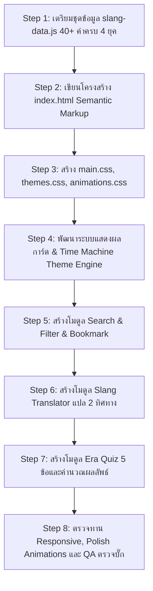

# 📖 Operational Runbook: พัฒนาเว็บ "แปลทีดิtionary" (PlaeThee-tionary)

เอกสารฉบับนี้กำหนดกฎเกณฑ์ บทบาท และข้อบังคับสำหรับ **AI Agent** ในการลงมือพัฒนาเว็บแอปพลิเคชัน **"แปลทีดิtionary"** ตามแผนงานที่ได้รับอนุมัติใน `project_plan.md` AI Agent ต้องอ่านและยึดถือแนวทางนี้อย่างเคร่งครัดก่อนและระหว่างการเขียนโค้ด

---

## 🎯 1. ภาพรวมและเป้าหมายของโปรเจกต์ (Mission Objective)

สร้างเว็บแอปพลิเคชันพจนานุกรมและระบบแปลคำแสลงอินเทอร์เน็ตไทยข้ามกาลเวลา 4 ยุค ที่มอบประสบการณ์น่าตื่นตาตื่นใจ (Rich Aesthetics & Wow Factor) ใช้งานได้จริง ไม่มีบั๊ก และมีความสมบูรณ์ของข้อมูล

* **ที่ตั้งโฟลเดอร์โปรเจกต์:** `c:\Users\acer\.gemini\antigravity-ide\scratch\plaethee-tionary`
* **เทคโนโลยีหลัก:** Vanilla HTML5, Vanilla CSS3, Vanilla JavaScript (ES6+)

---

## ✅ 2. สิ่งที่ AI ต้องทำ (Mandatory Requirements & Do's)

### 2.1 สถาปัตยกรรมและการแบ่งไฟล์ (Modular Code Structure)
1. **แยกไฟล์อย่างเป็นระเบียบตามหน้าที่ (Separation of Concerns):**
   - `index.html` — โครงสร้าง Semantic HTML5 รองรับ SEO
   - `styles/main.css` — Layout, Grid, Typography, Components
   - `styles/themes.css` — Theme Engine และ CSS Variables สำหรับ 4 ยุค
   - `styles/animations.css` — Keyframes, Glow, Micro-interactions, Transitions
   - `scripts/slang-data.js` — ฐานข้อมูลคำแสลงครบถ้วน 4 ยุค
   - `scripts/translator.js` — โมดูลแปลภาษาแสลง ↔ ภาษาทางการ
   - `scripts/quiz.js` — โมดูลมินิเกมคำถามและคิดคะแนนยุค
   - `scripts/app.js` — Event Listeners, State Management, LocalStorage
2. **ใช้ Vanilla CSS เต็มรูปแบบ:**
   - ใช้ CSS Variables (`--primary`, `--bg-color`, `--accent`, `--font-family`, `--card-bg`) ในการควบคุมธีม
   - ใช้ Modern Web Typography จาก Google Fonts (Prompt, Kanit, Space Grotesk)
   - มี Micro-animations เมื่อ Hover, คลิก หรือสลับยุค

### 2.2 คุณภาพและความครบถ้วนของข้อมูล (Rich Dataset)
1. **ฐานข้อมูลคำแสลงต้องมีขั้นต่ำ 40 คำ (อย่างน้อย 10 คำต่อยุค):**
   - **ยุค 90s (ICQ/Pirch/Pantip):** จ๊าบ, ปิ๊ง, นอยด์, เซ็งเป็ด, ดักแก่, กิ๊ก, ป้าดโธ่, อะฮ้า, ปลื้มปริ่ม, กินเด็ก
   - **ยุค 2000s (MSN/Hi5/Y2K):** แอ๊บแบ๊ว, เด็กแนว, เกรียน, ขำกลิ้ง, บับว่า, ตัวแม่ (ยุคเริ่มต้น), ชิเมโจได๋, ปลวก, รูปร่างดี, ตะเอง
   - **ยุค 2010s (BB/Twitter/FB):** จุงเบย, บ่องตง, ฝุดๆ, มโน, อัลไล, ติ่ง, นก, เผือก, มองบน, ตะมุตะมิ
   - **ยุค 2020s (TikTok/Gen Z/Alpha):** ช็อตฟีล, ดึงดาว, นอยด์อะแก, ฉ่ำ, จึ้ง, สภาพ, ตัวตึง, ชีทำถึง, ตัวบุตร, เต็มคาราเบล, วาสนาผู้ใด, สกิบิดี้
2. **การ์ดคำศัพท์ทุกคำต้องมีข้อมูลครบ 5 องค์ประกอบ:**
   - คำศัพท์และคำอ่าน
   - ความหมายทางการ (Formal Meaning)
   - บริบทที่มา/ยุคที่เริ่มต้น (Origin / Era)
   - ตัวอย่างบทสนทนา (Conversation Example)
   - ระดับความฮิต (Popularity Rating) และหมวดหมู่อารมณ์

### 2.3 ฟังก์ชันที่ต้องทำงานได้จริง 100% (Core Functionality)
1. **Dynamic Theme Engine (4 ยุค):**
   - สลับยุคแล้วเปลี่ยนสี, ฟอนต์, ขอบ และบรรยากาศของหน้าเว็บทันที
   - ยุค 90s: Retro Gray/Bevel/Pixel Green
   - ยุค 2000s: MSN Cyan/Glossy Pink Y2K
   - ยุค 2010s: Clean Flat Blue/Twitter Orange
   - ยุค 2020s: Dark OLED / Neon Pink-Cyan Glow / Glassmorphism
2. **Instant Search & Filter:**
   - พิมพ์ค้นหาแล้วแสดงผลแบบ Real-time โดยค้นหาได้ทั้งจากคำแสลงและความหมาย
   - มี Filter แยกตามยุคและตามหมวดหมู่อารมณ์
   - มีปุ่ม **"สุ่มคำแสลงทีดิ!" (Random)** สุ่มคำแสลงขึ้นมาไฮไลต์
3. **Slang Translator (เครื่องมือแปล 2 ทิศทาง):**
   - แปลภาษาแสลง ➡️ ภาษาทางการ
   - แปลภาษาทางการ ➡️ ภาษาแสลง
   - ไฮไลต์คำที่ถูกแปล และแสดงสรุปคำศัพท์ที่ถูกตรวจพบในประโยค
4. **มินิเกม Era Quiz ("คุณคือชาวเน็ตยุคไหน?"):**
   - มีคำถาม 5 ข้อ ให้เลือกความหมายของคำแสลง
   - ประมวลผลคะแนนและออกผลลัพธ์เป็น Title และ Badge ยุคที่ตรงกับผู้ใช้
   - มีปุ่มแชร์หรือเล่นซ้ำ
5. **ระบบคลังคำโปรด (Favorites/Bookmarks):**
   - กดรูปหัวใจหรือ Bookmark เพื่อเซฟคำศัพท์ลงใน LocalStorage
   - มีแท็บเปิดดู "คำโปรดของฉัน" ได้ตลอดเวลา

---

## ⛔ 3. สิ่งที่ AI ห้ามทำโดยเด็ดขาด (Strict Constraints & Don'ts)

1. ❌ **ห้ามใช้ Framework หรือ Library ภายนอกที่ไม่ได้รับอนุญาต:**
   - ห้ามใช้ Tailwind CSS (ให้เขียน Vanilla CSS เท่านั้น)
   - ห้ามติดตั้ง React, Vue, Angular หรือ Bundler หนักๆ เว้นแต่มีคำสั่งชัดเจน
2. ❌ **ห้ามใช้ Placeholder Text หรือข้อมูลปลอมไร้ความหมาย:**
   - ห้ามใส่ "Lorem Ipsum", "ตัวอย่างข้อความ 1", "คำศัพท์ 1 2 3"
   - ห้ามเว้นว่างตัวอย่างประโยคหรือบริบท ทุกคำต้องเป็นคำที่มีอยู่จริงในวัฒนธรรมเน็ตไทย
3. ❌ **ห้ามเขียนโค้ดมัดรวมเป็น Monolithic Script ก้อนเดียว:**
   - ห้ามยัด Logic ทุกอย่างลงใน `<script>` แท็กเดียวใน `index.html`
   - ต้องแบ่งโมดูล JavaScript และ CSS ตามที่ระบุไว้ในแผนงาน
4. ❌ **ห้ามปล่อยให้มี Broken Links, Broken Buttons หรือ Uncaught Errors:**
   - ปุ่มทุกปุ่มใน UI ต้องมี Event Listener รองรับ
   - ตรวจสอบ Console ต้องไม่มี Uncaught ReferenceError / TypeError
5. ❌ **ห้ามเขียนไฟล์ออกนอกขอบเขตโปรเจกต์:**
   - ทำงานเฉพาะในโฟลเดอร์ `c:\Users\acer\.gemini\antigravity-ide\scratch\plaethee-tionary` เท่านั้น
   - ห้ามเขียนไฟล์ทับโฟลเดอร์ระบบ (`.gemini/config` ฯลฯ)
6. ❌ **ห้ามละเลยความสวยงาม (Aesthetic Standards):**
   - ห้ามทำหน้าเว็บแบบเรียบจืดเหมือนการบ้านส่งครู (Plain White Background + Default Font สีฟ้า/ม่วง)
   - ต้องใช้สีมีมิติ, มี Gradient, เงา Box-shadow, Border-radius และ Responsive Breakpoint ชัดเจน

---

## 📋 4. ลำดับขั้นตอนการพัฒนา (Execution Sequence)

---

## 🧪 5. รายการตรวจสอบก่อนส่งมอบงาน (Acceptance Verification Checklist)

ก่อนจะถือว่างานเสร็จสมบูรณ์ AI Agent ต้องทดสอบผ่านเกณฑ์ดังต่อไปนี้:

- [ ] **การสลับยุค:** กดเลือกครบทั้ง 4 ยุค (90s, 2000s, 2010s, 2020s) และสไตล์หน้าเว็บเปลี่ยนตามจริง
- [ ] **ความสมบูรณ์ของข้อมูล:** มีคำแสลงแสดงผลไม่น้อยกว่า 40 คำ กระจายครบทุกยุค
- [ ] **การค้นหา:** พิมพ์ค้นหา "ตัวแม่" หรือ "นอยด์" แล้วผลลัพธ์กรองทันทีโดยไม่กระตุก
- [ ] **เครื่องมือแปล:** ทดสอบแปลทั้งไปและกลับ ข้อความแสดงผลถูกต้อง ไม่พัง
- [ ] **มินิเกม Quiz:** เล่นตอบคำถามได้ครบ 5 ข้อ และสรุปผลลัพธ์พร้อม Badge สำเร็จ
- [ ] **การจำลอง Bookmark:** กด Bookmark คำศัพท์แล้วรีเฟรชหน้าเว็บ ข้อมูลยังคงอยู่ (LocalStorage)
- [ ] **การแสดงผลมือถือ:** ทดสอบย่อขนาดหน้าจอแล้ว Grid การ์ดและ Menu ปรับเป็น Responsive ไม่ล้นจอ
