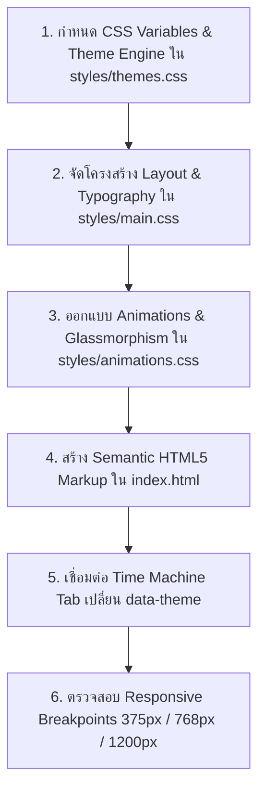

# 🎨 UI & Theme Engine Skill: "แปลทีดิtionary" (PlaeThee-tionary)

เอกสารฉบับนี้เป็นคู่มือปฏิบัติการสำหรับ **AI Agent** เมื่อต้องรับผิดชอบงานด้าน **ส่วนติดต่อผู้ใช้ (UI), การสร้างหน้าเว็บใหม่ (New Page), การสร้างคอมโพเนนต์ใหม่ (New Component), หรือการปรับแต่งระบบธีม 4 ยุค** ของเว็บแอปพลิเคชัน "แปลทีดิtionary"

---

## 🎯 1. พันธกิจและมาตรฐานความงาม (Mission & Aesthetic Standards)

เว็บ "แปลทีดิtionary" ต้องให้ความรู้สึก **"ว้าวตั้งแต่แรกเห็น" (Rich Aesthetics & WOW Factor)** ถ่ายทอดกลิ่นอายประวัติศาสตร์อินเทอร์เน็ตไทย 4 ยุคได้อย่างมีชีวิตชีวา ลื่นไหล สวยงามระดับพรีเมียม และไม่มีบั๊กด้านการแสดงผล

* **ขอบเขตโฟลเดอร์ UI:** `styles/main.css`, `styles/themes.css`, `styles/animations.css`, `index.html`
* **เทคโนโลยีบังคับ:** Vanilla HTML5 Semantic, Vanilla CSS3 (CSS Variables, Flexbox, CSS Grid)

---

## ✅ 2. กฎสิ่งที่ AI ต้องทำ (Mandatory UI Requirements & Do's)

### 2.1 สถาปัตยกรรม Dynamic Theme Engine (4 ยุคข้ามกาลเวลา)
ต้องรองรับการสลับสไตล์แบบทันทีผ่าน `:root[data-theme="..."]` โดยมี Design Tokens เฉพาะของแต่ละยุค:

1. **🌐 ยุค 90s (ICQ / Pirch98 / Webboard Pantip ยุคบุกเบิก):**
   - Palette: คอนกรีตเรโทร `--bg: #C0C0C0`, พื้นผิวหน้าต่าง `--surface: #DFDFDF`, สีกรมท่าคลาสสิก `--primary: #000080`, สีเขียวหัวเป็ด `--accent: #008080`
   - UI Texture: กรอบหน้าต่างนูน-บุ๋มแบบ 3D Bevel (`border: 2px outset #ffffff` / `inset #808080`), Title Bar สีน้ำเงินไล่เฉด, ไอคอนแบบ Bitmap/Pixel
   - Typography: Monospace หรือ Tahoma/Courier ผสมฟอนต์ไทยคมชัด

2. **💖 ยุค 2000s (MSN Messenger / Hi5 / Y2K Glossy Cyber):**
   - Palette: ชมพูสดใส `--accent: #FF1493`, ฟ้า MSN `--primary: #0084FF`, พื้นหลังสว่างสะอาดตา `--bg: #F0F4F8`, `--surface: #FFFFFF`
   - UI Texture: ปุ่มฟองสบู่ Glossy สะท้อนแสงเงา (`linear-gradient`, `box-shadow` นุ่มนวล), ขอบมนโค้งกลมมน (`border-radius: 16px`), อิโมจิสไตล์ MSN Emoticon
   - Typography: ฟอนต์สไตล์สดใส ขี้เล่น (Prompt / Kanit)

3. **📱 ยุค 2010s (BB PIN / Facebook ยุคแรก / Twitter Web 2.0):**
   - Palette: น้ำเงินเฟซบุ๊ก `--primary: #1877F2`, ส้มทวิตเตอร์สดใส `--accent: #FF7700`, พื้นหลังขาวคลีน `--bg: #F5F7FA`
   - UI Texture: Flat Design เรียบหรู สะอาดตา, เส้นขอบบางเฉียบ `1px solid #E4E6EB`, Card Shadow บางเบา
   - Typography: สะอาดตา อ่านง่าย (Prompt สไตล์บล็อกเกอร์ยุค 2010s)

4. **⚡ ยุค 2020s (TikTok / Gen Z / Dark Cyber Neon):**
   - Palette: ดำ Dark OLED `--bg: #0B0F19`, กล่องโปร่งแสง `--surface: rgba(20, 27, 45, 0.75)`, ฟ้าสะท้อนแสง `--primary: #00F2FE`, ชมพู TikTok นีออน `--accent: #FE0879`
   - UI Texture: Glassmorphism (`backdrop-filter: blur(16px)`), แสงสะท้อน Neon Glow รอบการ์ดและปุ่ม, เส้นสายเรืองแสงล้ำสมัย
   - Typography: สไตล์อนาคต (Space Grotesk + Kanit)

### 2.2 Micro-interactions & Transitions
1. ทุกปุ่มและการ์ดคำศัพท์ต้องมี Transition Effect เมื่อ Hover (เช่น ยกตัวขึ้น `transform: translateY(-4px)`, เงาฟุ้งขึ้น, สีเปลี่ยนนุ่มนวล 250ms)
2. เมื่อกดสลับธีมยุค ต้องมี Transition ครอบคลุมพื้นหลังและสีตัวอักษรอย่างราบรื่น ไม่กระพริบตา
3. สัญลักษณ์หัวใจ (Bookmark) ต้องมี Animation สั่นหรือขยายตัว (Scale pulse) เมื่อกดบันทึก

### 2.3 Semantic HTML5 & SEO Standards
1. โครงสร้างใช้ Semantic Tags: `<header>`, `<nav>`, `<main>`, `<section>`, `<article>`, `<footer>`
2. มี `<h1>` หลักเพียง 1 ตัวในหน้าเว็บพร้อม Title ที่น่าดึงดูด และ `<meta name="description">`
3. ทุก Element ที่กดได้ (Interactive Elements) ต้องมี `id` หรือ `data-action` ชัดเจนและ Cursor เป็น Pointer

### 2.4 Mobile-first Responsive Layout
1. รองรับหน้าจอ 3 ขนาดหลัก:
   - Mobile: 375px - 767px (Grid 1 คอลัมน์, เมนูและแท็บยุคแนวนอน Scroll ได้สะดวก)
   - Tablet: 768px - 1023px (Grid 2 คอลัมน์)
   - Desktop: 1024px+ (Grid 3-4 คอลัมน์, จัดวางสัดส่วนสวยงาม กึ่งกลางหน้าจอ)
2. ห้ามเกิด Horizontal Overflow (ไม่มีแถบเลื่อนแนวนอนกวนใจบนจอมือถือ)

---

## ⛔ 3. กฎสิ่งที่ AI ห้ามทำโดยเด็ดขาด (Strict UI Don'ts)

1. ❌ **ห้ามใช้ Framework หรือ Library ภายนอกที่ไม่ได้รับอนุญาต:**
   - ห้ามใช้ Tailwind CSS, Bootstrap หรือ Component Library ภายนอก ให้เขียน Pure Vanilla CSS เท่านั้น
2. ❌ **ห้ามทำหน้าเว็บแบบเรียบจืด จอขาวไร้มิติ:**
   - ห้ามทำหน้าเว็บที่ดูเหมือนเอกสาร Word หรือการบ้านส่งครู (ห้ามพื้นหลังขาวล้วน ไม่มีเงา ไร้ลูกเล่น)
3. ❌ **ห้าม Hardcode สีตายตัวลงในคลาสคอมโพเนนต์:**
   - ทุกสี ทุกพื้นผิว และเงา ต้องอ้างอิงผ่าน CSS Custom Variables เพื่อให้รองรับการเปลี่ยนธีม 4 ยุคได้สมบูรณ์
4. ❌ **ห้ามปล่อยให้ Layout พังหรือข้อความล้นกล่อง:**
   - ห้ามปล่อยให้ข้อความยาวๆ ล้นทะลุการ์ดคำศัพท์ (ใช้ `word-break: break-word` หรือ `text-overflow`)
5. ❌ **ห้ามใช้ Image Placeholder ที่ไม่มีความหมาย:**
   - ห้ามใช้ลิงก์ภาพหลอก เช่น `via.placeholder.com` หากต้องใช้ไอคอนให้ใช้ SVG Inline หรือ Unicode Emojis ที่เข้ากับแต่ละยุค

---

## 📋 4. ลำดับขั้นตอนการพัฒนา UI (UI Execution Sequence)

---

## 🧪 5. รายการตรวจสอบก่อนส่งมอบ UI (UI Acceptance Checklist)

- [ ] **Dynamic Theme:** กดเลือกครบ 4 ยุคแล้ว สไตล์ สีสัน ฟอนต์ และขอบเปลี่ยนตามอัตลักษณ์แต่ละยุคจริง 100%
- [ ] **Responsive Test:** ย่อขนาดหน้าจอเหลือ 375px แล้วการ์ดและปุ่มจัดเรียงตัวสวยงาม ไม่มีแถบเลื่อนแนวนอน
- [ ] **Micro-animations:** ปุ่มและการ์ดมี Interaction ที่ชัดเจนเมื่อ Hover หรือกดคลิก
- [ ] **Contrast & Readability:** ตัวหนังสืออ่านง่ายชัดเจนบนทุกธีม (ทั้ง Dark Mode ยุค 2020s และ Retro ยุค 90s)
- [ ] **Vanilla CSS:** โค้ดทั้งหมดเขียนด้วย Vanilla CSS ไม่มี Tailwind CSS หรือ Library อื่นแปลกปลอม
